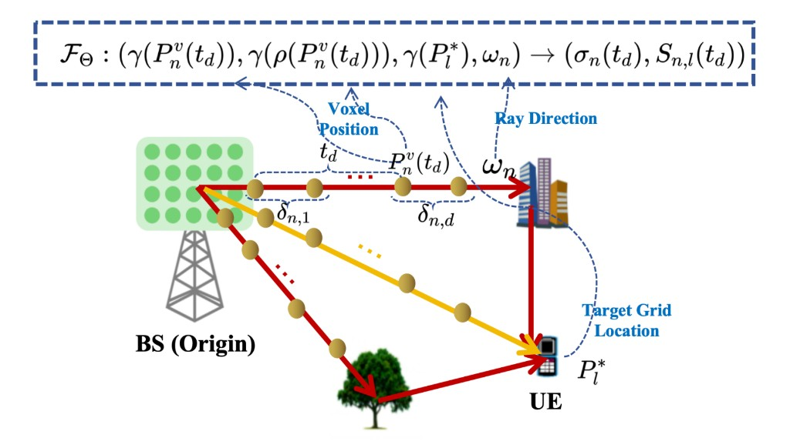

# MM-LSCM

<p align="center">
  <a href="https://arxiv.org/abs/2508.06054"></a>
  <a href="https://ieeexplore.ieee.org/document/11591021"></a>
  <a href="https://yeehengwang.github.io/MM-LSCM/"></a>
  
</p>

<p align="center">
  
  
  
  
  
</p>

**Official code** for *[Multi-Modal Neural Radio Radiance Field for Localized Statistical Channel Modelling](https://arxiv.org/abs/2508.06054)*  
([IEEE Xplore](https://ieeexplore.ieee.org/document/11591021) · [Project page](https://yeehengwang.github.io/MM-LSCM/)).

> [Yiheng Wang](https://yeehengwang.github.io/), Shutao Zhang, [Ye Xue](https://yokoxue.github.io/) and [Tsung-Hui Chang](https://myweb.cuhk.edu.cn/changtsunghui/Home)  
> Shenzhen Research Institute of Big Data / The Chinese University of Hong Kong, Shenzhen

**Drive-test RSRP alone cannot see the environment—and labeled APS is expensive.**  
MM-LSCM learns a neural radio radiance field from **RSRP + LiDAR**, recovers the Angular Power Spectrum **without APS labels**, and cuts Sub-Task 1 MAE from **1.85 dB (WNOMP) → 0.87 dB**.

<p align="center">
  
</p>

<p align="center">
  Rays from the BS query a dual-branch field; stop probability aligns channel APS $\hat{\mathbf{x}}$ with obstacle depth $\hat{z}$.
</p>

---

## Highlights

- **Self-supervised LSCM** — train with $\hat{\mathbf{y}}_l = \Phi \hat{\mathbf{x}}_l$; no ground-truth APS
- **Multi-modal** — RSRP + LiDAR density; SM-LSCM ablation ships in the same repo
- **Volume rendering** — shared stop probability $\nu_n(t)$ for radio APS and geometry depth
- **Stronger & more robust** — beats WNOMP / SM-LSCM on explored & unexplored grids, under noise

| Method | Sub-Task 1 MAE ↓ | Sub-Task 2 MAE ↓ | Sub-Task 3 MAE ↓ |
| --- | ---: | ---: | ---: |
| **MM-LSCM** | **0.87** | **0.56** | **0.90** |
| SM-LSCM | 1.09 | 0.70 | 1.10 |
| WNOMP | 1.85 | — | — |

Sub-Task 1: rotated RSRP @ explored · Sub-Task 2: RSRP @ unexplored · Sub-Task 3: rotated RSRP @ unexplored.

---

## Method (short)

Dual-branch field $\mathcal{F}_\Theta:(\gamma(P^v),\gamma(\rho),\gamma(P_l^*),\omega)\rightarrow(\sigma,S)$.  
Along each ray, stop weight $\nu=\mathcal{T}\sigma$ renders:

$$
\hat{r}_{l,n}=\int \nu_n(t)\, S_{l,n}(t)\, dt,\quad
\hat{\mathbf{x}}_l=\big[|\hat{r}_{l,n}|^2\big]_n,\quad
\hat{z}_n=\int \nu_n(t)\, t\, dt
$$

$$
\ell=\|\mathbf{y}-\Phi\hat{\mathbf{x}}\|_2^2+\lambda_1\|\hat{\mathbf{x}}\|_1
+\lambda_2\|z-\hat{z}\|_2^2
$$

(radio reconstruction + APS sparsity + LiDAR depth). Full derivations → [arXiv:2508.06054](https://arxiv.org/abs/2508.06054).

---

## Setup

```bash
pip install -r requirements.txt
# or: pip install torch numpy scipy pyyaml tqdm tensorboard
ln -sf dataloader_aps.py dataloader_aps_new.py   # runners import this name
```

**Data.** Experiments follow the indoor laboratory setting of [NeRF²](https://github.com/XPengZhao/NeRF2). Prepare RSRP / locations / point cloud in the layout below (a starter split is under `demo_data/`).

```text
demo_data/
├── RSRP_data.npy                         # (N, 32)
├── location.npy                          # (N, 3)
├── pc6k_farthest_downsampled_points.txt
├── train_index_indoor.txt
├── test_index_indoor.txt
├── Matrix_A_before.npy                   # (32, N_angles)  ← required
└── Matrix_A_after.npy                    # rotated config   ← required
```

`Matrix_A_*` map APS → beam RSRP for the original / rotated antenna config. Build them for your angle grid (or adapt from your NeRF²-based preprocessing), then set `path.datadir` in the YAML.

---

## Quick Start

```bash
# MM-LSCM (RSRP + LiDAR)
python MM_LSCM_runner.py --config ./MM_LSCM.yml --gpu 0 --mode train --dataset_type rsrp
python MM_LSCM_runner.py --config ./MM_LSCM.yml --gpu 0 --mode test  --dataset_type rsrp

# SM-LSCM (RSRP-only baseline)
python SM_LSCM_runner.py --config ./SM_LSCM.yml --gpu 0 --mode train --dataset_type rsrp
python SM_LSCM_runner.py --config ./SM_LSCM.yml --gpu 0 --mode test  --dataset_type rsrp
```

Logs → `logdir` in YAML (`./MM_LSCM/log`, `./SM_LSCM/log`).

| Config key | Meaning | Default |
| --- | --- | --- |
| `render.n_samples` | Samples / ray | 96 |
| `render.scale_worldsize` | Coord normalize | 300 |
| `train.lr` / `total_iterations` | Adam / steps | `1e-4` / 30000 |
| `networks.D` / `W` | MLP depth / width | 8 / 256 |

```text
MM-LSCM/
├── MM_LSCM_*.py / SM_LSCM_*.py   # model, renderer, runner
├── MM_LSCM.yml / SM_LSCM.yml
├── dataloader_aps.py
├── demo_data/
├── docs/index.html               # project page
└── assets/framework.png
```

---

## Citation

```bibtex
@inproceedings{wang2025multi,
  title={Multi-modal neural radio radiance field for localized statistical channel modelling},
  author={Wang, Yiheng and Zhang, Shutao and Xue, Ye and Chang, Tsung-Hui},
  booktitle={2025 IEEE Globecom Workshops (GC Wkshps)},
  pages={1005--1010},
  year={2025},
  organization={IEEE}
}
```

Preprint: [arXiv:2508.06054](https://arxiv.org/abs/2508.06054) · IEEE: [document/11591021](https://ieeexplore.ieee.org/document/11591021).

---

## Acknowledgements

Supported by the National Key R&D Program of China (2023YFB2904804), NSFC 62301334, and the Guangdong Major Project of Basic and Applied Basic Research (2023B0303000001).  
Thanks to NeRF² for paving the path.

## Keywords

`NeRF` · `neural radiance field` · `wireless communications` · `channel modeling` · `LSCM` · `APS` · `RSRP` · `LiDAR` · `multi-modal` · `self-supervised learning` · `volume rendering` · `radio propagation` · `digital twin` · `PyTorch` · `GLOBECOM`

## Contact

Open an issue, or contact the authors via affiliations on the paper page.
